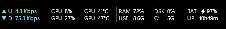
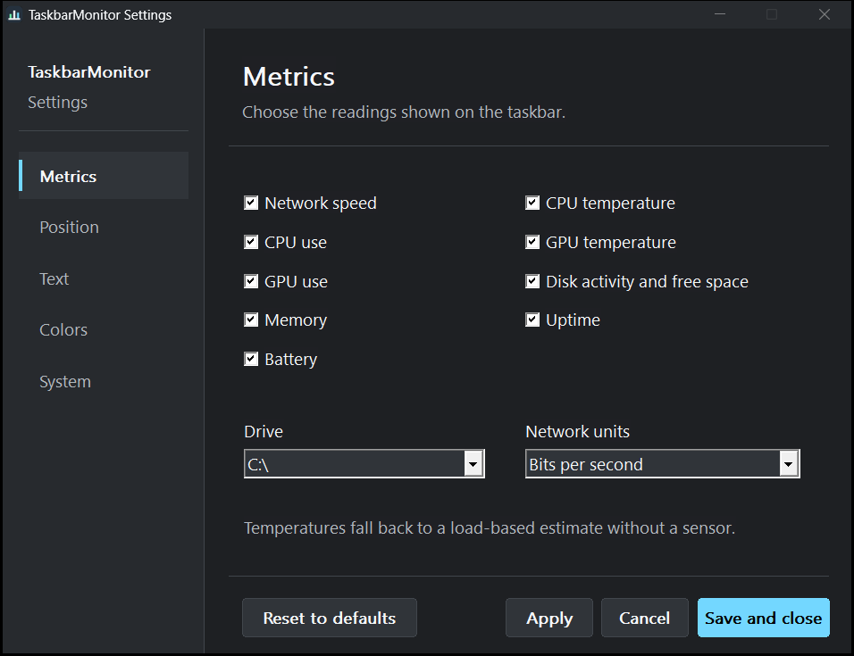

# TaskbarMonitor


Hardware monitor that runs inside the Windows taskbar. Written in C++17 using Win32 APIs and double-buffered GDI, with LibreHardwareMonitor embedded for direct sensor readings.

The logo source is [assets/logo.svg](assets/logo.svg). The Windows icon and PNG are generated with `python tools/generate_icon.py` (requires Pillow and PyMuPDF for asset generation only).

## Automatic updates

TaskbarMonitor checks the public GitHub releases API on startup and every 24 hours.
No GitHub token is needed. When a newer stable version is available, you can choose
whether to download, install, and restart. Disable automatic checks in
**Settings → Advanced → Check for updates automatically**, then click **Apply**.

Updates require a writable application folder. Downloads are checked against
GitHub's SHA-256 release digest and the executable version before replacement.
Failed checks leave the monitor running; failed replacements preserve the old
executable. Releases without a checksum are not installed automatically.

## Screenshots

### Taskbar monitor



### Settings



## Metrics

The monitor renders a two-row status block inside the taskbar.

Network readings show transfer rates, not cumulative totals. Small transfers use B/s or bps so they do not round down to zero; larger rates use KB/s, MB/s, or the corresponding bit units. A full interval with no traffic still shows zero.

| Metric | Display | Data Source |
| :--- | :--- | :--- |
| Network | Upload / Download speed | GetIfTable2 across active non-loopback interfaces |
| CPU Usage | CPU % | GetSystemTimes kernel, idle, and user differentials |
| CPU Temp | Degrees Celsius | Embedded LibreHardwareMonitor, native thermal zones, or explicitly marked estimates |
| GPU Usage | GPU % | PDH \GPU Engine(*)\Utilization Percentage (capped at 100%) |
| GPU Temp | Degrees Celsius | Embedded LibreHardwareMonitor, NVIDIA/AMD driver APIs, or explicitly marked estimates |
| Memory | RAM % and Used GB | GlobalMemoryStatusEx |
| Disk | Activity % and Free Space | PDH PhysicalDisk(_Total) and GetDiskFreeSpaceExW |
| Battery | Charge % and AC status | GetSystemPowerStatus (hides automatically on AC-only desktops) |
| Uptime | System uptime | GetTickCount64 |

If a system lacks an exposed thermal sensor, the monitor estimates temperature based on system load. Estimates are marked with `~` (for example, `~65°C`); measured readings have no prefix. GPU utilization reports the busiest physical engine, combining process counters for that engine rather than summing unrelated engines.

## Built-in temperature readings

Open **Settings → Temperatures**:

LibreHardwareMonitorLib 0.9.6, its dependencies, and the sensor bridge are embedded in TaskbarMonitor.exe and loaded in-process. Readings start automatically; there is **no separate LibreHardwareMonitor app, web server, port, or connection setup**.

The page shows detected temperatures and their sensor sources, **Refresh sensors**, and **Use detected readings**. CPU package and physical Tdie sensors take priority over core/hotspot readings; generic ACPI zones and temperature limits are not presented as measured CPU temperatures. Real readings above 90°C remain visible with a cooling warning; they are never capped to make them look safer.

When a reading is unavailable, **Enable sensor access** applies pending settings and requests Windows UAC permission. The current monitor stays running until an elevated copy validates the handoff; cancellation or launch failure leaves it open. The new copy reloads your settings and opens Temperatures. Use the same Windows account when approving UAC.

Some CPU readings also require the signed PawnIO driver. Elevation does not install a missing driver or disable Windows security protections. Unknown readings show N/A on this page; taskbar estimates remain marked with `~`. Automatic updates pause in elevated sessions so the temporary PowerShell updater never runs with administrator rights; normal launches resume update checks.

The .NET Framework 4.7.2+ runtime is required (included on current Windows releases). Bundled files are extracted automatically to a content-addressed cache under `%LOCALAPPDATA%\TaskbarMonitor\Sensors`; their bytes are checked against the embedded resources before loading. The managed runtime increases memory usage compared with the native-only monitor. Upstream licenses and source links are embedded and available in the license dialog and **Source and licenses**.

## Settings

Open the configuration window by double-clicking the tray icon or right-clicking and selecting Settings.
You can also launch `TaskbarMonitor.exe --settings` to open it directly.

### Metrics
Toggle metrics on or off. Set the target drive letter for storage monitoring and select network speed units (Bytes/s or Bits/s).

### Position
- Alignment: Left, Right (tray adjacent), Center, or Custom.
- Coordinates: The horizontal offset is measured from the taskbar edge. The vertical nudge shifts the readings up or down inside the taskbar band.
- The monitor is a child of the taskbar. It sits in a gap clear of Search, app buttons, and the system tray, and never floats above the desktop. Brief layout-read failures reuse the last valid layout for up to two seconds.
- The monitor fills the taskbar band, so it matches the taskbar height and DPI automatically. Each value sits directly after its label, and the reserved width keeps routine updates from resizing or shifting the layout.
- When auto-hide collapses the taskbar, the monitor slides away with it.
- Item gap spacing adjusts the space between readings.
- Dividers: Toggle vertical lines between metric columns.

### Text
- Font: Choose any installed Windows font.
- Size: 1 pt to 24 pt.
- Weight: Normal, Medium, Semi-Bold, or Bold.
- Preview: Shows the selected font with current CPU and memory readings before saving.

### Colors
- Presets: Auto (matches Windows accent and dark/light mode), Dark, Light, or Custom.
- Custom colors: Independent color pickers for labels, values, upload, download, dividers, and background.
- Transparent background: Toggles window color-key transparency.
- Auto-contrast: Adjusts font luminosity when background contrast falls below readable thresholds.

### System
- Polling Rate: Sensor refresh interval in milliseconds (minimum 100 ms, default 1000 ms).
- Settings Theme: Follow Windows, Dark Mode, or Light Mode.
- Autostart: Writes the executable path to the per-user Run key and checks whether Windows Startup Apps has disabled it. The Advanced tab shows the effective state. Enabling the option repairs a Windows-side disable, while unrelated settings changes leave an external disable untouched.
- Click-Through Mode: Sets WS_EX_TRANSPARENT so mouse clicks pass directly to the taskbar.

### Temperatures
- Built-in LibreHardwareMonitor, live hardware status, sensor refresh, and one-click use of detected readings. No external sensor setup.
- Settings-save errors are reported without closing the settings window; some registry values may already have been written, so retry after fixing permissions.

## Tray Menu

Right-click the notification icon in the system tray:

- Settings: Opens configuration window.
- Open Task Manager: Runs taskmgr.exe.
- Refresh Theme: Re-reads Windows colors and redraws immediately.
- Click-Through Mode: Toggles mouse click pass-through.
- Exit Monitor: Closes the application.

## Build Requirements

- Compiler: MinGW-w64 (GCC 10+) or MSVC (Visual Studio 2019+)
- Windows SDK
- C++17 support
- .NET Framework 4.7.2+ and its C# compiler (included with the Framework)
- First build: internet access to fetch the pinned, SHA-256-verified LibreHardwareMonitor archive and upstream notices. End users do not need this download.

### Build with Batch File (MinGW)
Runs windres, builds TaskbarMonitor.exe with g++, and self-signs the binary:
```bat
build.bat
```

### Build with Make
```bat
make
```

### Build with CMake
```bat
mkdir build
cd build
cmake ..
cmake --build . --config Release
ctest --output-on-failure -C Release
```

### Linked System Libraries
- iphlpapi
- gdi32
- dwmapi
- pdh
- psapi
- shell32
- comctl32
- comdlg32
- ole32
- oleaut32
- wbemuuid
- advapi32

### Optional Runtime Libraries
These are loaded dynamically via LoadLibraryW when present:
- nvml.dll: NVIDIA Management Library (temperature)
- nvapi64.dll or nvapi.dll: NVIDIA API fallback
- atiadlxx.dll or atiadlxy.dll: AMD Display Library (temperature)

If neither the embedded backend nor native sensors provide a reading, temperature falls back to a load-based estimate marked with `~`.

## Configuration & Uninstallation

All settings are stored in the Windows Registry under:
`HKCU\Software\TaskbarMonitor`

Autostart entry:
`HKCU\Software\Microsoft\Windows\CurrentVersion\Run\TaskbarMonitor`

To uninstall, disable autostart in Settings, close the program, and delete the executable. The extracted sensor cache can also be deleted from `%LOCALAPPDATA%\TaskbarMonitor\Sensors`. TaskbarMonitor installs no background service or hardware driver.

When the application is launched manually, a startup prompt appears only when Windows startup is not effectively enabled. Launches from the startup entry do not show the prompt. Choosing Keep Disabled leaves the current Windows startup state unchanged.

## Release packaging

Build the release executable, then run `powershell -NoProfile -ExecutionPolicy Bypass -File tools/package_release.ps1 -Executable build-check/TaskbarMonitor.exe`.
The ZIP contains exactly `TaskbarMonitor/TaskbarMonitor.exe` using forward slashes, as required by the 1.2.5 updater. MinGW builds statically link their runtimes so the updater does not need to extract extra DLLs.

## License

TaskbarMonitor is MIT licensed. The embedded LibreHardwareMonitor library is MPL 2.0; its dependencies retain their upstream licenses. Full notices and source links are included in the executable's license dialog and extracted sensor cache.
