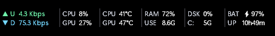
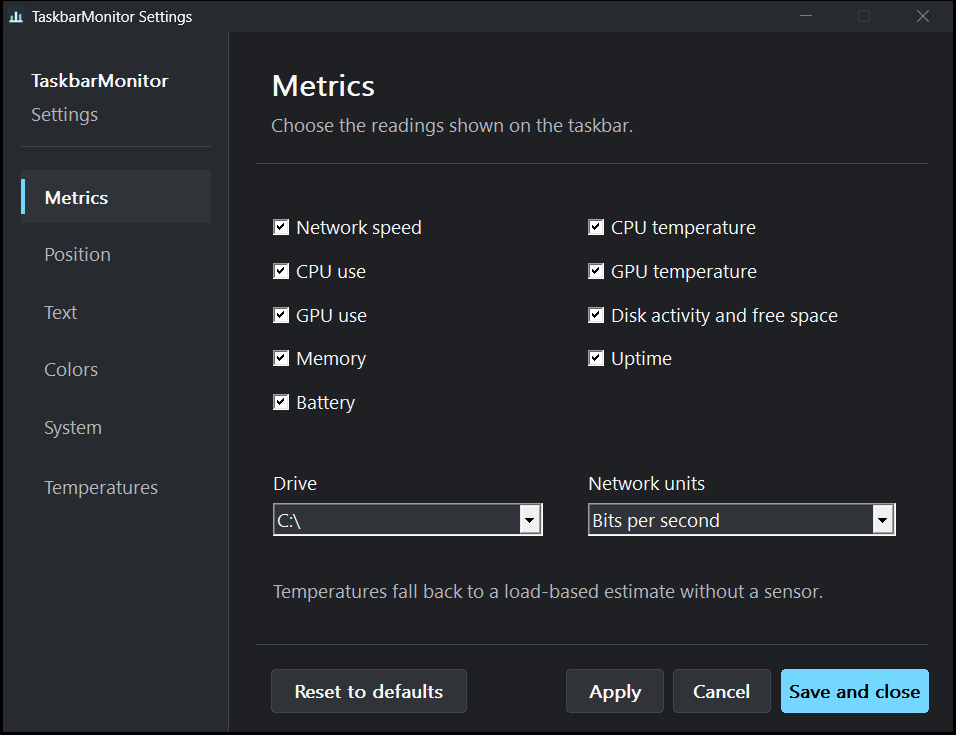
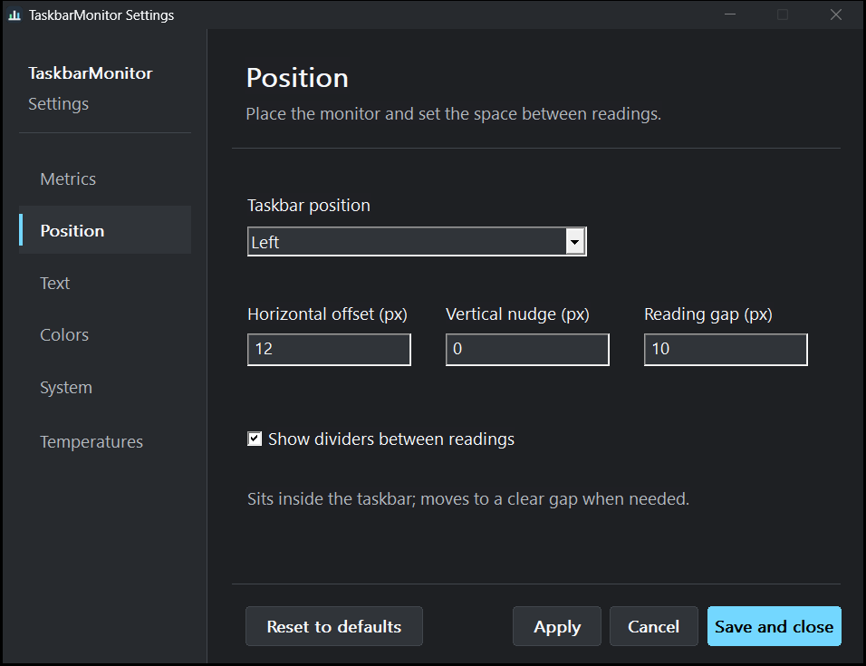
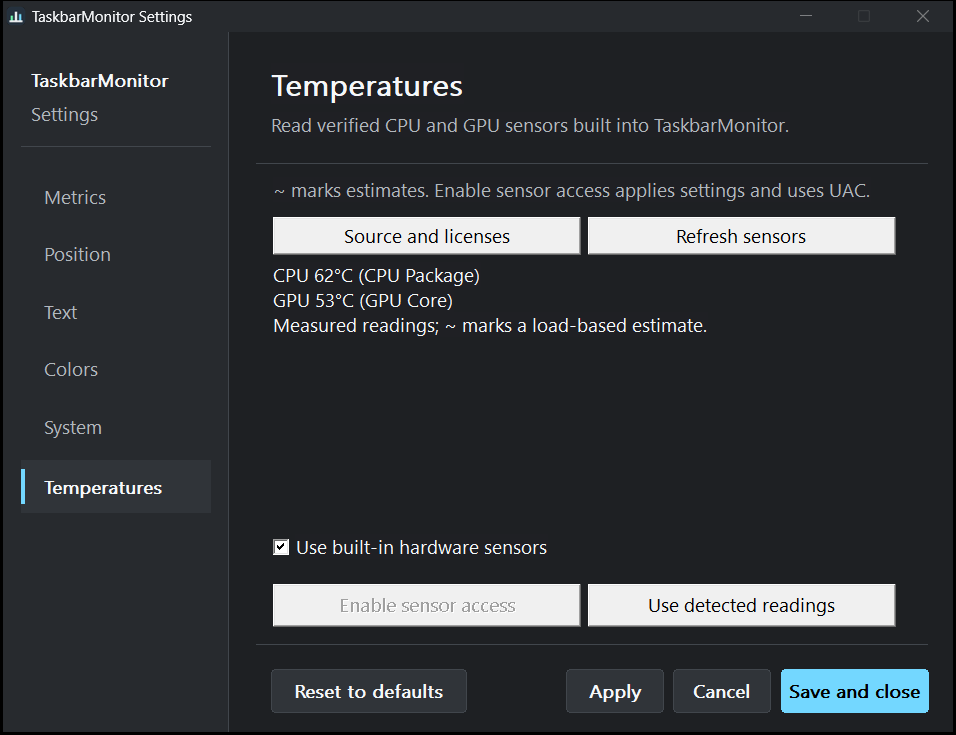

# TaskbarMonitor


See network speeds, CPU and GPU usage and temperatures, memory, disk space, battery, and uptime right in the Windows taskbar.

**[Download TaskbarMonitor for Windows](https://github.com/kuy124/TaskbarMonitor/releases/latest)**



## Quick start

1. Download the ZIP under **Assets**, extract it, and run `TaskbarMonitor.exe`.
2. When prompted, choose whether to start with Windows and use measured temperatures.
3. Double-click the tray icon to open **Settings**. If it’s hidden, look under the arrow beside the clock. Pick the readings you want under **Metrics**, then click **Apply**.



## Customize the taskbar

- **Position:** Move the monitor to the left, center, or next to the system tray. Choose **Custom coordinates** to fine-tune placement, and adjust spacing and dividers here too.
- **Text and Colors:** Pick a font, change the colors, or use a transparent background.
- **System:** Change **Start with Windows** and **Check for updates automatically**.



## CPU and GPU temperatures

If you skipped measured temperatures at setup, check **Use built-in hardware sensors** in **Settings → Temperatures** and click **Apply**. Choose **Refresh sensors** to check for readings, then **Use detected readings** to show them on the taskbar.

A `~` means the temperature is estimated. If a sensor shows `N/A`, try **Enable sensor access** or **Install sensor driver** if offered. Windows may ask for administrator permission.



*Example readings. Available sensors depend on your hardware.*

To remove TaskbarMonitor, turn off **Start with Windows**, choose **Exit Monitor** from the tray menu, and delete the extracted app folder.

<details>
<summary>Build from source</summary>

On Windows, use CMake with an x64 C++17 toolchain (MinGW-w64 or MSVC) and .NET Framework 4.7.2 or later.

```powershell
cmake -S . -B build
cmake --build build --config Release
ctest --test-dir build -C Release --output-on-failure
```

</details>

TaskbarMonitor is MIT-licensed. For bundled components, see **Settings → Temperatures → Source and licenses**.
